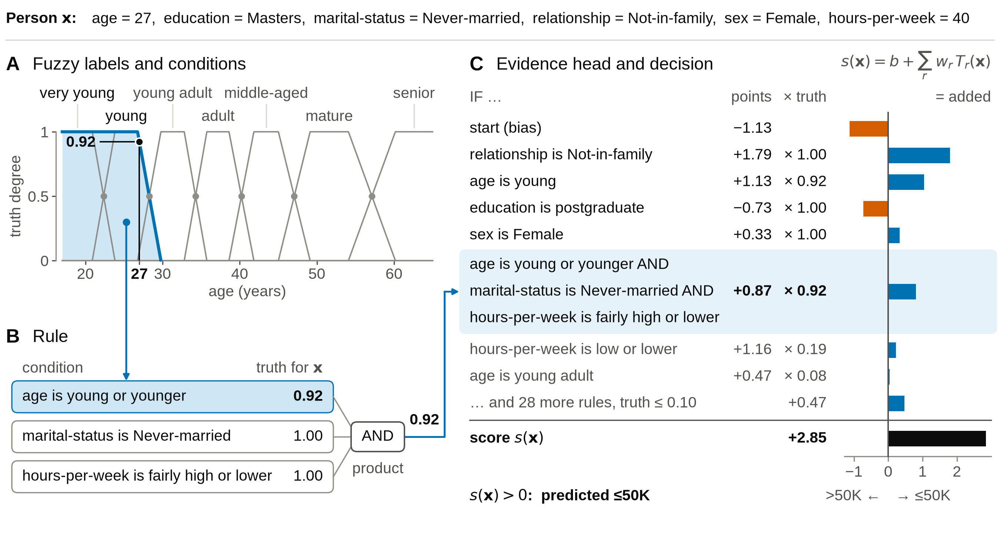

# FLARE: Fuzzy Learned-Antecedent Rule Evidence

FLARE is a differentiable rule learner, significantly better than the competition in performance and size. It uses
short and simple rules with interpretable fuzzy partitions. Take a look at the example below to know how FLARE works.



*For one test person of the adult dataset. (A) Each real variable is described by fuzzy labels. (B) The truth of a rule
is the product of the truths of its conditions. (C) The score starts at the bias, every rule adds its points times its
truth degree, and the final decision is taken.*

## Abstract

Rule learners are used where transparency and accountability are required, because they give practitioners patterns
they can read. Learning rules is a discrete problem, so neurosymbolic pipelines that use rules as explanations rely on
relaxations such as the straight-through estimator. However, these differentiable rule learners often lag behind both
classical rule learners and black-box classifiers in terms of performance. We study which parts of a rule-based
classifier (conditions, rule length, rule weights, sufficiency and interactions) affect performance, and how well
gradient-based training learns each of them. Based on our results, we propose FLARE (Fuzzy Learned-Antecedent Rule
Evidence), a differentiable rule learner that learns simple rules that combine to make the final decision. We also
propose a learned encoding for variables with thousands of categories. We test FLARE on tabular data, using 42 datasets
of OpenML-CC18 and the 38 classification tasks of TabArena. On CC18, FLARE exceeds the compared rule learners by 7.69 to
12.38 macro-F1 points and performs comparably to random forests, while remaining 1.00 to 1.11 points below tuned
gradient-boosted trees. On TabArena it ranks at the same level as random forests and ahead of the other rule learners.
As the concept-to-label head of a concept bottleneck model, FLARE is the best rule-based head in five of six settings.
On graphs, it is competitive on PubMed and EMOGI but falls behind graph neural networks on Cora and Citeseer.

## Repository

```
flare/          the method (a PyTorch package)
baselines/      the compared methods: builders, search spaces and adapters to the authors' code
experiments/    data loaders, runners, job lists and the scripts of the tables and figures
docs/           the figure above
tests/          unit tests
```

## Install

    pip install -e .                     # the method: numpy, pandas, scikit-learn, scipy, torch
    pip install -e ".[experiments]"      # + OpenML, Optuna, matplotlib: the scripts of the paper
    pip install -e ".[baselines]"        # + the compared methods that come from pip (see baselines/README.md)
    pip install -e ".[corels]"           # + CORELS, which builds from source (a C++ compiler and GMP)
    pip install -e ".[graphs,cbm]"       # + what the graph and the concept bottleneck experiments read (h5py, torchvision)

Python 3.10 or later. A GPU is used when PyTorch sees one (the training step is then replayed as a CUDA graph); every
result can also be computed on a CPU, more slowly.

## Use

```python
from flare import FLAREClassifier, flare, flare_explainability

model = FLAREClassifier(flare()).fit(X_train, y_train, categorical=mask)   # mask: True for categorical columns (codes 0..K-1)
model.predict(X_test)
model.predict_proba(X_test)
print(model.print_rules())
```

`flare()` is the configuration of the paper that aims at performance (8 averaged models of 120 rules, 100 of them with
one condition), `flare_explainability()` the one that aims at a small rule base (one model of 40 rules). Every option
is in `flare/config.py`, e.g. `flare(rules=60, labels=5)`.

## Data

The repository holds no data. The tabular benchmarks are downloaded from OpenML on first use (42 OpenML-CC18 datasets,
`experiments/data/cc18.json`, and the 38 classification tasks of TabArena v0.1, `experiments/data/tabarena.json`) and
cached in `$FLARE_DATA_DIR` (default `~/.cache/flare`). The graph and image datasets are described in
`experiments/README.md`: what is downloaded automatically and what you have to download yourself and pass as a path.

## Reproducing the paper

`experiments/README.md` lists, for every table and figure of the paper, the commands that produce its runs and the
script that builds it from them. In short, for the tabular results:

    python -m baselines.fetch_external                       # the authors' code of RRL, RL-Net, DR-Net and NeuRules
    python -m experiments.jobs --out results                 # job lists: one command per line, each one resumable
    python -m experiments.run_jobs results/jobs/flare.txt --workers 4
    python -m experiments.run_jobs results/jobs/flare_tuned.txt --workers 4
    python -m experiments.run_jobs results/jobs/baselines_cc18.txt --workers 32
    python -m experiments.run_jobs results/jobs/baselines_tabarena.txt --workers 32
    python -m experiments.paper.table1 --results results --out results/tables          # Table 1 and its paired tests
    python -m experiments.paper.fig_size --results results --out results/figures       # Figure 2
    python -m experiments.paper.fig_scalability --results results --out results/figures   # Figure 3

The tuned runs dominate the cost (30 configurations or one hour per fold for every method): plan for several thousand
CPU hours and a few hundred GPU hours, or run the lines of a job list on a cluster (each line is independent).

## Tests

    pip install -e ".[experiments,dev]"
    pytest                                   # unit tests (CPU; the tests of an optional part skip when its extra is missing)

## Licence

MIT (`LICENSE`). The compared methods keep their own licences (`baselines/README.md`); the authors' code is cloned at
run time, not distributed here.
